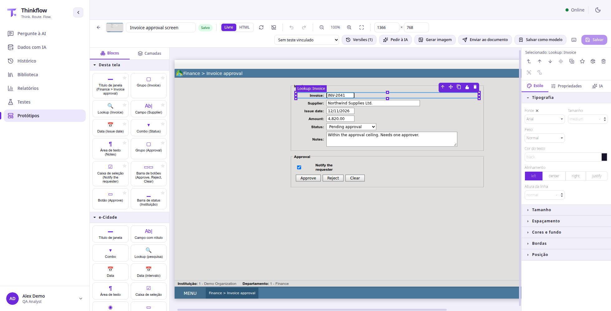
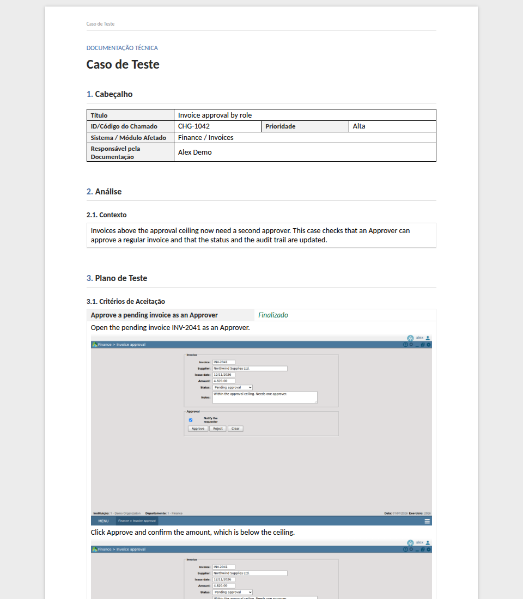
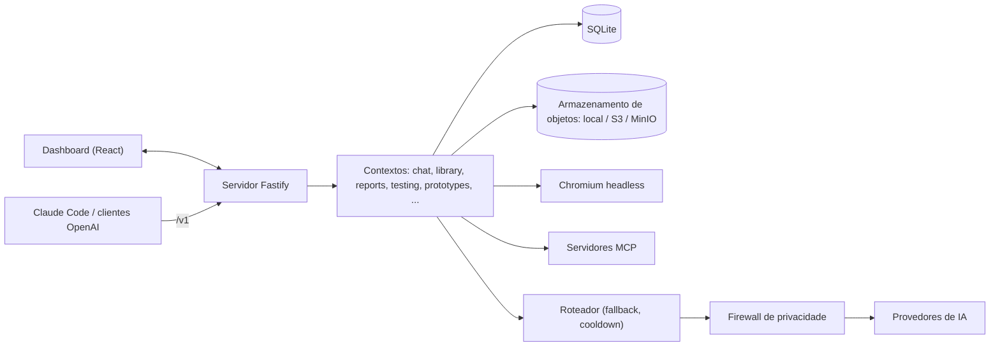

# Thinkflow

**Um espaço de trabalho de IA auto-hospedado para analistas e QA**: roteia as chamadas de modelo entre
provedores com fallback automático, protege dados pessoais antes que saiam da sua máquina e traz
ferramentas de evidência de testes e de protótipos de telas de sistemas web legados.

[](https://github.com/cristianoDencode/thinkflow/actions/workflows/ci.yml)
[](https://github.com/cristianoDencode/thinkflow/actions/workflows/codeql.yml)
[](LICENSE)


[Read in English](README.en.md)



> A interface está em português do Brasil. O código e a documentação em `docs/` estão em inglês; este
> arquivo é a versão em português do [README em inglês](README.en.md).

## O que é o Thinkflow

Analistas e QA de times que mantêm sistemas web legados lidam com várias coisas ao mesmo tempo:
provedores de IA com limites de plano gratuito que falham na hora errada, dados que não podem sair da
organização, evidências de teste montadas à mão e telas que precisam ser esboçadas antes de serem
construídas. O Thinkflow é um único espaço de trabalho auto-hospedado para tudo isso. Um usuário local,
o SQLite e, opcionalmente, um bucket S3 bastam para rodar; não há serviço em nuvem para assinar.

## Recursos

**Gateway de IA e roteamento**

- Conexões com OpenRouter, Groq, Mistral, NVIDIA NIM, DeepSeek, Ollama/LM Studio, Anthropic, OpenAI ou
  qualquer endpoint compatível, reunidas em **combos** (modelos virtuais com uma lista ordenada).
- **Fallback e cooldown**: em 429, cota esgotada, 5xx ou erro de rede, a próxima conexão é usada e a que
  falhou entra em cooldown, respeitando o `Retry-After`. Veja [docs/routing.md](docs/routing.md).
- Um **gateway `/v1` compatível com Anthropic e OpenAI**, para que o Claude Code (CLI e VS Code) e
  clientes OpenAI usem seus combos ([docs/claude-code.md](docs/claude-code.md)).
- **Servidores MCP** (stdio e HTTP) como ferramentas do chat, **Modo Agente** que roda o Claude Code
  pelo Claude Agent SDK e **uso** com projeções e orçamento mensal opcional ([docs/usage.md](docs/usage.md)).

**Espaço de trabalho do analista**

- Chat com histórico, resumos incrementais, derivação de conversas e diagramas Mermaid.
- **Biblioteca**: PDF, DOCX, Markdown e imagens com OCR e busca em texto completo, citados no chat; motor
  NotebookLM experimental ([docs/library.md](docs/library.md)).
- **Dados com IA** sobre Postgres: verificação de SQL somente leitura, amostras mascaradas e cartões de
  resultado com exportação CSV ([docs/data-ai.md](docs/data-ai.md)).
- **Relatórios e modelos** gerados em segundo plano, em HTML, Markdown ou PDF
  ([docs/reports.md](docs/reports.md)).

**Firewall de privacidade**

- Dados pessoais (CPF, CNPJ, e-mail, telefone, nomes e mais) são trocados por códigos reversíveis antes de
  qualquer chamada de modelo e restaurados na resposta, em todos os caminhos de chamada, inclusive modelos
  locais. Sidecar Presidio opcional ([docs/privacy.md](docs/privacy.md)).

**Kit de QA**

- Grave um teste manual em um navegador real ("Gravar") ou apenas colete prints ("Só prints"), com editor
  de evidências anotadas, verificações e reexecução com conjuntos de dados.
- **Documentos de caso de teste** em DOCX, PDF e HTML. As categorias do documento são fixas; os modelos
  permitem que você (ou a IA) desenhe apenas a aparência. Envio de um arquivo novo por caso de teste para
  um OneDrive pessoal ([docs/testing.md](docs/testing.md), [docs/onedrive.md](docs/onedrive.md)).

**Editor de protótipos**

- Capture uma tela durante uma gravação, ou importe de um mapeador de telas, e edite com o GrapesJS no
  modo **Livre** (posicionamento absoluto, arrastar, seleção múltipla, agrupar, bloqueio de camada,
  autosave a cada 2 s) ou no modo **HTML**, sobre o mesmo documento. Assistente de IA, versões,
  renderização em PNG e "enviar ao caso de teste".
- **Perfis de sistema**: o e-Cidade, um ERP municipal brasileiro de código aberto, é o primeiro perfil
  embutido ([docs/prototypes.md](docs/prototypes.md)).

## Capturas de tela

|                                          |                                                           |
| ---------------------------------------- | --------------------------------------------------------- |
|             |                |
|  |  |

## Início rápido

Requisitos: Node.js 22.12 ou mais novo (recomendado 24) e pnpm 10.

```bash
pnpm install
pnpm dev
```

Isso inicia a API em `http://localhost:3737` e o dashboard em `http://localhost:5173`. Abra o dashboard e
crie seu usuário local (nome e senha) na primeira visita. Depois:

1. **Conexões, Nova conexão**: escolha um provedor e cole a chave de API.
2. **Conexões, Combos, Novo combo**: arraste os alvos na ordem de preferência.
3. **Pergunte à AI**: escolha o combo e converse. Ligue o **MCP** para usar as ferramentas cadastradas.

Produção, em um único processo servindo a API e o dashboard em `http://localhost:3737`:

```bash
pnpm build
pnpm start
```

Docker, com os dados em `./data`:

```bash
docker compose up -d --build
```

O contêiner é publicado apenas em `127.0.0.1:3737`. Os serviços opcionais são perfis do Compose:
`docker compose --profile minio up -d` adiciona o MinIO para armazenamento S3 ([docs/storage.md](docs/storage.md))
e `docker compose --profile privacy up -d --build` adiciona o Presidio ([docs/privacy.md](docs/privacy.md)).
A imagem não inclui Chromium por padrão; use `docker build --build-arg WITH_CHROMIUM=true .` para habilitar
a geração de PDF/PNG. A gravação de testes exige o Thinkflow na sua própria máquina, não no Docker. Todas
as variáveis estão em [docs/configuration.md](docs/configuration.md).

## Arquitetura em resumo



- Monorepo pnpm: `apps/server` (Fastify), `apps/web` (React 19) e `packages/shared` (contratos Zod usados
  pelos dois lados).
- O servidor tem 15 bounded contexts, cada um dividido em `domain`, `application`, `infrastructure` e
  `interface`, com as camadas verificadas no CI pelo dependency-cruiser.
- Todo o tráfego de modelo passa por um único roteador, que aplica o firewall de privacidade antes de
  qualquer chamada a provedor.
- O SQLite guarda os dados; os arquivos vão para um armazenamento de objetos plugável (disco, S3 ou MinIO).
- O Chromium headless grava testes e gera PDFs e PNGs; sem ele, o resto continua funcionando.

Mais em [docs/architecture.md](docs/architecture.md) e nos [registros de decisão](docs/adr/).

## Documentação

A documentação em `docs/` está em inglês.

| Tema                                     | Página                                             |
| ---------------------------------------- | -------------------------------------------------- |
| Arquitetura, contextos, fluxo            | [docs/architecture.md](docs/architecture.md)       |
| Roteamento, combos, fallback             | [docs/routing.md](docs/routing.md)                 |
| Claude Code e clientes OpenAI            | [docs/claude-code.md](docs/claude-code.md)         |
| Biblioteca, OCR, NotebookLM              | [docs/library.md](docs/library.md)                 |
| Dados com IA                             | [docs/data-ai.md](docs/data-ai.md)                 |
| Firewall de privacidade                  | [docs/privacy.md](docs/privacy.md)                 |
| Testes: gravação, evidências, documentos | [docs/testing.md](docs/testing.md)                 |
| Editor de protótipos                     | [docs/prototypes.md](docs/prototypes.md)           |
| Contrato de importação do mapeador       | [docs/mapper-contract.md](docs/mapper-contract.md) |
| Relatórios e modelos                     | [docs/reports.md](docs/reports.md)                 |
| Uso, histórico e contexto                | [docs/usage.md](docs/usage.md)                     |
| Armazenamento de arquivos e MinIO        | [docs/storage.md](docs/storage.md)                 |
| OneDrive                                 | [docs/onedrive.md](docs/onedrive.md)               |
| Referência de configuração               | [docs/configuration.md](docs/configuration.md)     |
| Registros de decisão de arquitetura      | [docs/adr/](docs/adr/)                             |

## Roteiro

- Provedores via OAuth (por exemplo, GitHub Copilot) e detecção de cota por provedor.
- Custo estimado por modelo na página Uso.
- Busca semântica (embeddings) e pré-busca automática na biblioteca, sem depender de tool calling.
- Biblioteca no modo Agente e lista de permissão por ferramenta MCP nos modelos de documento.
- Anexar um relatório diretamente ao chat e capa do PDF sem cabeçalho e rodapé.
- Mais perfis de sistema para o editor de protótipos e um mapeador de telas publicado que o alimente
  ([docs/mapper-contract.md](docs/mapper-contract.md)).

## Contribuindo

Contribuições são bem-vindas. Leia o [CONTRIBUTING.md](CONTRIBUTING.md) (em inglês) para preparar o
ambiente, rodar os testes e conhecer as regras de arquitetura, e o [Código de Conduta](CODE_OF_CONDUCT.md).
O [CHANGELOG](CHANGELOG.md) lista as mudanças.

## Segurança

O Thinkflow executa comandos de servidores MCP stdio e no Modo Agente, guarda chaves de provedores e pode
lidar com dados pessoais: leia o [SECURITY.md](SECURITY.md) para o modelo de segurança e relate
vulnerabilidades de forma privada pelos GitHub Security Advisories.

## Licença

[MIT](LICENSE) © 2026 Cristiano Aquino
