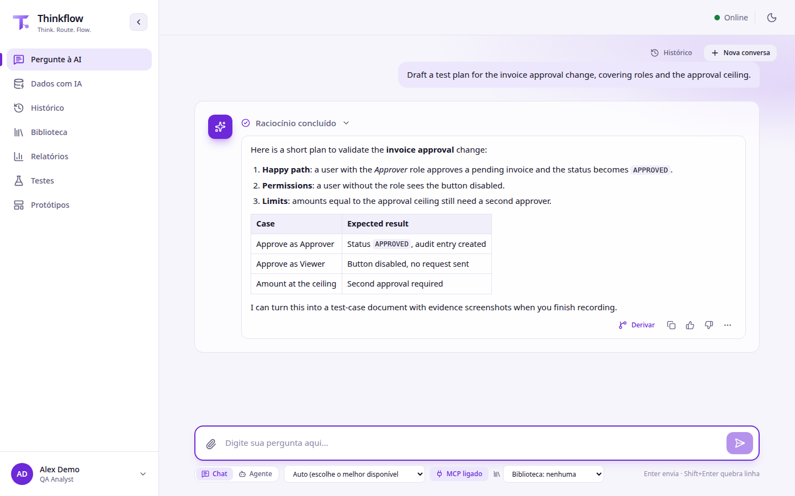
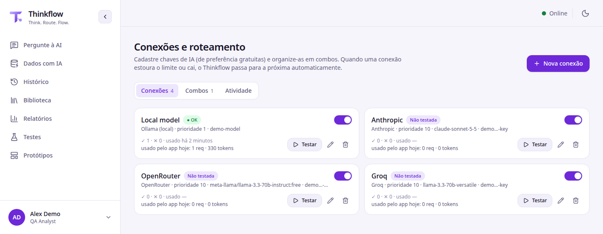
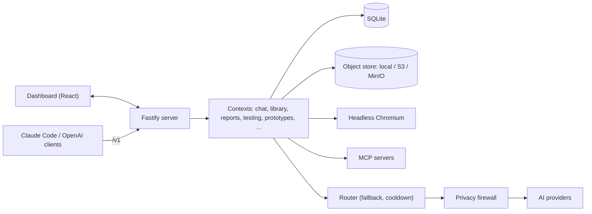

# Thinkflow

**A self-hosted AI workspace for analysts and QA**: it routes model calls across providers with
automatic fallback, protects personal data before it leaves your machine, and adds tools for test
evidence and screen prototypes of legacy web systems.

[](https://github.com/cristianoDencode/thinkflow/actions/workflows/ci.yml)
[](https://github.com/cristianoDencode/thinkflow/actions/workflows/codeql.yml)
[](LICENSE)


[Leia em português](README.pt-BR.md)


> The interface is in Brazilian Portuguese. The code, the documentation and this README are in
> English, and a [Portuguese README](README.pt-BR.md) is available.

## What is Thinkflow

Analysts and QA in teams that maintain legacy web systems juggle several things at once: AI
providers with free-tier limits that fail at the worst moment, data that must not leave the
organization, test evidence that has to be assembled by hand, and screens that need to be sketched
before they are built. Thinkflow is one self-hosted workspace for all of it. A single local user,
SQLite and an optional S3 bucket are enough to run it; there is no cloud service to sign up for.

## Features

**AI gateway and routing**

- Connections to OpenRouter, Groq, Mistral, NVIDIA NIM, DeepSeek, Ollama/LM Studio, Anthropic,
  OpenAI or any compatible endpoint, grouped into **combos** (virtual models with an ordered list).
- **Fallback and cooldown**: on 429, exhausted quota, 5xx or network errors the next connection is
  used and the failing one cools down, honoring `Retry-After`. See [docs/routing.md](docs/routing.md).
- An **Anthropic- and OpenAI-compatible `/v1` gateway** so Claude Code (CLI and VS Code) and OpenAI
  clients can use your combos ([docs/claude-code.md](docs/claude-code.md)).
- **MCP servers** (stdio and HTTP) as chat tools, **Agent mode** that runs Claude Code through the
  Claude Agent SDK, and **usage** with projections and an optional monthly budget
  ([docs/usage.md](docs/usage.md)).

**Analyst workspace**

- Chat with history, incremental summaries, forking and Mermaid diagrams.
- **Library**: PDF, DOCX, Markdown and images with OCR and full-text search, cited in chat; an
  experimental NotebookLM engine ([docs/library.md](docs/library.md)).
- **Data with AI** over PostgreSQL: read-only SQL checks, masked samples, result cards with CSV
  export ([docs/data-ai.md](docs/data-ai.md)).
- **Reports and templates** generated in the background, as HTML, Markdown or PDF
  ([docs/reports.md](docs/reports.md)).

**Privacy firewall**

- Personal data (CPF, CNPJ, e-mail, phone, names and more) is replaced by reversible tokens before
  any model call and restored in the answer, for every call path, including local models. Optional
  Presidio sidecar ([docs/privacy.md](docs/privacy.md)).

**QA toolkit**

- Record a manual test in a real browser ("Gravar") or just collect screenshots ("Só prints"), with
  an annotated evidence editor, assertions, and replay with data sets.
- **Test-case documents** in DOCX, PDF and HTML. The document categories are fixed; models let you
  (or the AI) design only the look. Upload a new file per test case to a personal OneDrive
  ([docs/testing.md](docs/testing.md), [docs/onedrive.md](docs/onedrive.md)).

**Prototype editor**

- Capture a screen during a recording, or import one from a screen mapper, and edit it with
  GrapesJS in **Free** mode (absolute positioning, drag, multi-select, group, layer lock, autosave
  every 2 s) or **HTML** mode on the same document. AI assistant, versions, PNG render, and "send
  to test case".
- **System profiles**: e-Cidade, an open-source Brazilian municipal ERP, is the first built-in
  profile ([docs/prototypes.md](docs/prototypes.md)).

## Screenshots

|                                             |                                                       |
| ------------------------------------------- | ----------------------------------------------------- |
|                |                |
|  |  |

## Quick start

Requirements: Node.js 22.12 or newer (24 recommended) and pnpm 10.

```bash
pnpm install
pnpm dev
```

This starts the API on `http://localhost:3737` and the dashboard on `http://localhost:5173`. Open
the dashboard and create your local user (name and password) on the first visit. Then:

1. **Conexões, Nova conexão**: pick a provider and paste its API key.
2. **Conexões, Combos, Novo combo**: drag targets in order of preference.
3. **Pergunte à AI**: choose the combo and chat. Turn on **MCP** to use registered tools.

Production, as a single process serving the API and the dashboard on `http://localhost:3737`:

```bash
pnpm build
pnpm start
```

Docker, with data kept in `./data`:

```bash
docker compose up -d --build
```

The container is published on `127.0.0.1:3737` only. Optional services are Compose profiles:
`docker compose --profile minio up -d` adds MinIO for S3 storage ([docs/storage.md](docs/storage.md))
and `docker compose --profile privacy up -d --build` adds Presidio
([docs/privacy.md](docs/privacy.md)). The image has no Chromium by default; build with
`docker build --build-arg WITH_CHROMIUM=true .` to enable PDF/PNG rendering. Test recording needs
Thinkflow on your own machine, not in Docker. All variables are in
[docs/configuration.md](docs/configuration.md).

## Architecture at a glance



- A pnpm monorepo: `apps/server` (Fastify), `apps/web` (React 19) and `packages/shared` (Zod
  contracts used by both).
- The server has 15 bounded contexts, each split into `domain`, `application`, `infrastructure`
  and `interface`, with the layering enforced in CI by dependency-cruiser.
- All model traffic goes through one router, which applies the privacy firewall before any provider
  call.
- SQLite stores data; files go to a pluggable object store (disk, S3 or MinIO).
- Headless Chromium records tests and renders PDFs and PNGs; without it the rest keeps working.

More in [docs/architecture.md](docs/architecture.md) and the [decision records](docs/adr/).

## Documentation

| Topic                                 | Page                                               |
| ------------------------------------- | -------------------------------------------------- |
| Architecture, contexts, request flow  | [docs/architecture.md](docs/architecture.md)       |
| Routing, combos, fallback             | [docs/routing.md](docs/routing.md)                 |
| Claude Code and OpenAI clients        | [docs/claude-code.md](docs/claude-code.md)         |
| Library, OCR, NotebookLM              | [docs/library.md](docs/library.md)                 |
| Data with AI                          | [docs/data-ai.md](docs/data-ai.md)                 |
| Privacy firewall                      | [docs/privacy.md](docs/privacy.md)                 |
| Tests: recording, evidence, documents | [docs/testing.md](docs/testing.md)                 |
| Prototype editor                      | [docs/prototypes.md](docs/prototypes.md)           |
| Mapper import contract                | [docs/mapper-contract.md](docs/mapper-contract.md) |
| Reports and templates                 | [docs/reports.md](docs/reports.md)                 |
| Usage, history and context            | [docs/usage.md](docs/usage.md)                     |
| File storage and MinIO                | [docs/storage.md](docs/storage.md)                 |
| OneDrive                              | [docs/onedrive.md](docs/onedrive.md)               |
| Configuration reference               | [docs/configuration.md](docs/configuration.md)     |
| Architecture decision records         | [docs/adr/](docs/adr/)                             |

## Roadmap

- OAuth providers (for example GitHub Copilot) and per-provider quota detection.
- Estimated cost per model on the Usage page.
- Semantic search (embeddings) and automatic library pre-search that does not depend on tool calling.
- Library in Agent mode, and per-tool MCP allow lists in document templates.
- Attach a report directly to a chat, and a PDF cover without header and footer.
- More system profiles for the prototype editor, and a published screen mapper that feeds it
  ([docs/mapper-contract.md](docs/mapper-contract.md)).

## Contributing

Contributions are welcome. Read [CONTRIBUTING.md](CONTRIBUTING.md) for setup, tests and the
architecture rules, and the [Code of Conduct](CODE_OF_CONDUCT.md). See the
[CHANGELOG](CHANGELOG.md) for what changed.

## Security

Thinkflow runs commands for MCP stdio servers and in Agent mode, stores provider keys, and may
handle personal data: read [SECURITY.md](SECURITY.md) for the security model, and report
vulnerabilities privately through GitHub Security Advisories.

## License

[MIT](LICENSE) © 2026 Cristiano Aquino
