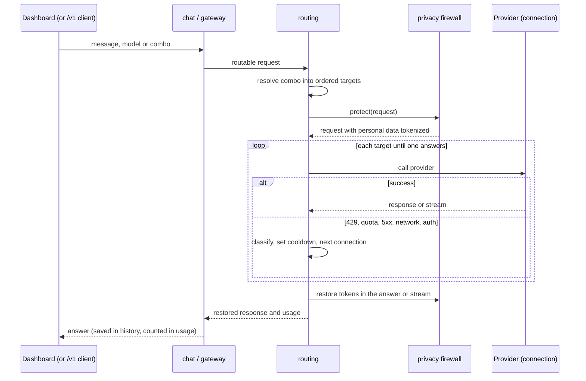

# Architecture

Thinkflow is a TypeScript monorepo with a Fastify server, a React dashboard and a package of
shared contracts. The server is organized as **bounded contexts** with layered, enforced
dependencies (see [ADR 0001](adr/0001-ddd-bounded-contexts-enforced-by-dependency-cruiser.md)).

## Monorepo layout

| Path              | What it is                                                                                  |
| ----------------- | ------------------------------------------------------------------------------------------- |
| `apps/server`     | Fastify 5 API, SQLite (Drizzle ORM + migrations), MCP client pool, headless Chromium driver |
| `apps/web`        | React 19 dashboard (Vite, Tailwind 4, TanStack Query, GrapesJS, Konva for evidence editing) |
| `packages/shared` | Zod schemas and TypeScript types shared by both sides, plus a few pure functions            |
| `deploy/minio`    | Script and policy that prepare a MinIO bucket and a least-privilege user                    |
| `docker/presidio` | Optional Presidio sidecar image (personal-data detection for free text)                     |

In production a single Node process serves the API and the built dashboard.

## Bounded contexts

Each context lives in `apps/server/src/contexts/<context>/{domain,application,infrastructure,interface}`.

| Context       | Responsibility                                                                                        |
| ------------- | ----------------------------------------------------------------------------------------------------- |
| `identity`    | The local user, password hashing, sessions and router API keys                                        |
| `connections` | Provider catalog, connections (keys encrypted at rest), combos and quota tracking                     |
| `routing`     | Model resolution, error classification, cooldown and backoff, connection selection, the fallback loop |
| `protocol`    | Anthropic and OpenAI wire formats: request translation, SSE streams, usage accumulation               |
| `gateway`     | The `/v1/*` endpoints compatible with Anthropic and OpenAI                                            |
| `mcp`         | Registry of MCP servers (stdio and HTTP) and the pool of clients                                      |
| `chat`        | Conversations, history, context budget and summaries, the MCP tool loop, Data mode and Agent mode     |
| `usage`       | Token accounting per day, provider, model and origin; projections and budget                          |
| `library`     | Document libraries, text extraction and OCR, full-text index, chat tool, NotebookLM engine            |
| `reports`     | Document templates, background report generation, Mermaid normalization, HTML/PDF rendering           |
| `databases`   | PostgreSQL connections, read-only SQL guard and execution, masking, data tools for the chat           |
| `privacy`     | Personal-data detectors, tokenizing vault, firewall applied to every model call, column rules         |
| `testing`     | Test sessions: recording, evidence, replay, data sets, test-case documents (DOCX, PDF, HTML)          |
| `prototypes`  | Screen prototypes: capture and import, sanitizing, versions, templates, AI assistant, PNG rendering   |
| `onedrive`    | OneDrive (personal Microsoft account) authorization and upload of new `.docx` files                   |

Shared code lives in `apps/server/src/shared`:

- `kernel`: pure helpers (clock, ids, errors, the `ObjectStore` port, namespace scoping);
- `infrastructure`: configuration, crypto (`SecretBox`, scrypt), SQLite client and schema,
  settings store, object-store adapters (local, S3, in memory);
- `interface/http`: error handler and the settings and storage routes.

`apps/server/src/app.ts` is the **composition root**: it builds the adapters, wires the use cases
and registers the routes.

## Layering rules

Enforced in CI by [dependency-cruiser](../.dependency-cruiser.cjs) (`pnpm depcruise`):

- `domain` imports no `application`, `infrastructure`, `interface` or `app.ts`, and no npm
  framework (only `@thinkflow/shared` and Node built-ins).
- `application` depends on domain and ports only: no adapters, no HTTP, no Fastify, Drizzle,
  MCP SDK, Playwright, AWS SDK, unified/remark/rehype or `pg`.
- Only `shared/infrastructure/storage` may import the S3 SDK.
- `shared/kernel` imports only other kernel files; `shared/interface` never imports a context.
- Adapters never import HTTP route modules; no circular dependencies; production code never
  imports tests.

## Persistence

- **SQLite** (`DATA_DIR/thinkflow.sqlite`, better-sqlite3) holds metadata, conversations, the
  full-text index (FTS5), settings, usage and encrypted credentials. The schema is in
  `apps/server/src/shared/infrastructure/db/schema.ts`; migrations are generated with
  `pnpm --filter @thinkflow/server db:generate` and applied at startup.
- **Object store** (`STORAGE_DRIVER=local|s3`) holds user files that must outlive the process.
  Every module sees only its own namespace, with keys of the form
  `<STORAGE_PREFIX><namespace>/<generated ids>/<file>`. Namespaces: `reports`, `library`, `tests`,
  `documents`, `images`, `prototypes`. Details in [storage.md](storage.md).
- `DATA_DIR/secret.key` holds the generated secret when `THINKFLOW_SECRET` is not set.

## Headless Chromium

The server drives Chromium through `playwright-core` (pinned to the same version as
`@playwright/test` so both reuse one browser revision) for:

- recording tests in a visible browser and capturing screens for prototypes;
- rendering PDFs of reports and test-case documents, and PNGs of prototypes;
- validating and rendering Mermaid diagrams server side.

Without Chromium everything else keeps working: documents are produced as HTML or Markdown and
the PDF/PNG actions are disabled with an explanation. The renderer runs with external requests
blocked. The Docker image omits Chromium unless built with `WITH_CHROMIUM=true`.

## Request flow of a chat call

See [routing.md](routing.md) for how targets are chosen and [privacy.md](privacy.md) for what the
firewall does.

## Web app

`apps/web/src/features/*` has one folder per area (chat, connections, data-ai, databases,
history, integrations, library, mcp, prototypes, reports, settings, tests, usage). Server state
goes through TanStack Query; request and response types come from `@thinkflow/shared`. The UI
language is Brazilian Portuguese.
